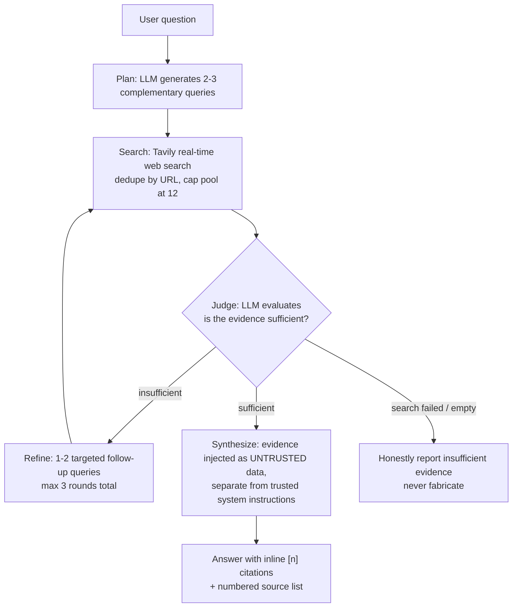

# Sourced · A Research Agent That Brings Its Sources


> Turning a question into a **sourced, verifiable answer** — every claim carries a citation you can open and check.

ODSC × Nebius Hackathon 2026 · Team **KK_yuanqu** · Oct 28 – Nov 20

**Sourced** is a research agent for anyone who needs answers they can defend — students writing papers, analysts briefing clients, engineers comparing technologies. Search engines give you links; chatbots give you confident prose. Sourced gives you a synthesized answer where **every factual claim is tied to a numbered, clickable source**, and when the evidence isn't there, it says so instead of inventing.

## How it works



**The research loop is visible.** Every run prints (and with `--trace` saves) its full decision trace: what queries were planned, how many sources each round added, why the agent stopped searching, and what the final answer cites. See [a real trace](traces/20261116_161304.md).

### Design decisions, mapped to what good research looks like

| Decision | Why |
|---|---|
| Citations `[n]` must resolve to a real URL in the source list — no dangling refs | A citation that can't be opened is decoration, not evidence |
| Judge step decides *continue vs stop* searching (max 3 rounds) | More searches ≠ better answers; stop when evidence converges |
| Web content is injected as **untrusted data**, never merged into system instructions | Source pages may contain prompt-injection attempts |
| Search failures, empty pools, and thin evidence are **reported, never smoothed over** | "I couldn't verify this" is a valid research output; hallucinated certainty is not |
| Conflicting sources are surfaced in the answer, not averaged away | Reviewers need to know where evidence disagrees |

## Quick start

Requirements: Python 3.10+, a [Tavily](https://app.tavily.com) API key (free tier: 1,000 calls/month), and any OpenAI-compatible inference key.

```bash
pip install -r requirements.txt
cp .env.example .env        # Windows: copy .env.example .env
# edit .env:
#   TAVILY_API_KEY=tvly-...                          (from app.tavily.com)
#   LLM_BASE_URL=https://api.tokenfactory.nebius.com/v1
#   LLM_API_KEY=...                                  (Nebius Token Factory)
#   LLM_MODEL=deepseek-ai/DeepSeek-V4.1-Flash-1017

python test_tavily.py       # verifies the search path end-to-end
```

**Web UI** (recommended):

```bash
streamlit run app.py        # or: python -m streamlit run app.py
```

Type a question, watch the live research trace (planning → search rounds → sufficiency judgment → source ranking), get an answer with **clickable inline citations**, and an honest warning when evidence is insufficient. The sidebar always shows the active inference endpoint and model — a reviewer can verify the Nebius Token Factory backend live during any run, without opening a trace file.

**CLI** (same core, thin adapter):

```bash
python agent.py "What won the 2026 Nobel Prize in Physics, and for what work?"
python agent.py "..." --trace      # also saves the research trace to traces/
```

The inference layer is deliberately pluggable (`llm.py`): switching providers — e.g. to Nebius Token Factory — is a three-line `.env` change, no code edits. API keys live only in `.env`, which is git-ignored.

### Example output (real run)

> **Conclusion:** The 2026 Nobel Prize in Chemistry was awarded to **Henri B. Kagan** and **Kenso Soai** "for the discovery of non-linear effects and autocatalysis in asymmetric organic synthesis" [1][2][5][6]. The Royal Swedish Academy of Sciences announced the award, with the official citation given in both English and Swedish sources [1][5][6]. …
>
> - **What the work showed:** Kagan discovered a way of manipulating chemical reactions that allows a greater excess of one mirror image ("enantiomer") to be created than previously assumed possible, while Soai demonstrated autocatalysis — one product of the reaction acting as its own catalyst [3][4]. …
> - **Note on sourcing:** All six sources are consistent on the laureates and citation wording; no conflicts appear in the evidence. The only discrepancy is a garbled birthplace in the [1] auto-transcript, noted above.

Notice the shape of the answer: conclusion first, claims cited, sources cross-checked against each other — and a data-quality caveat where one source is defective. That paragraph is the product.

### Verified runs — five real traces

Every run below is a saved trace in [`traces/`](traces/), produced by an unmodified `agent.py` against live Tavily + Nebius Token Factory (`deepseek-ai/DeepSeek-V4.1-Flash-1017`). Each trace header records the inference endpoint and model used.

| Trace | Question | Rounds (pool size) | Sources cited | Outcome |
|---|---|---|---|---|
| [`20261116_161244`](traces/20261116_161244.md) | 2026 Nobel Prize in Chemistry | 1 (6) | 6 | Converged in round 1 — well-documented facts |
| [`20261116_161304`](traces/20261116_161304.md) | Federal Reserve rate cuts in 2024 | 2 (6 → 9) | 9 | Converged after one targeted follow-up |
| [`20261116_161732`](traces/20261116_161732.md) | TSMC 3nm ramp and products, 2025 | 3 (8 → 12 → 15) | 12 | Coverage-driven follow-ups; demote + cap recorded in trace |
| [`20261116_161434`](traces/20261116_161434.md) | U.S. real GDP 2024, BEA estimate revisions | 3 (8 → 12 → 14) | 12 | Rounds exhausted; answer leads with explicit caveats |
| [`20261116_161549`](traces/20261116_161549.md) | Nebius data center codenamed "Aurora-7" | 3 (9 → 14 → 17) | 12 | **Insufficient evidence — stated, not invented** |

**What each run demonstrates**

1. **Targeted follow-up, not blind re-searching.** In the TSMC run the judge decomposed the question into sub-questions (ramp metrics, product adopters), found the product-adopter evidence missing after each round, and issued queries aimed at exactly that gap — three rounds, each with its own gap list and follow-up queries. The Fed run closed its gap in a single follow-up round.
2. **Source ranking is observable, never silent.** Every trace names both its demotions and its discards. The GDP run demoted two `investing.com` entries to the tail, then capped the pool 14 → 12 and recorded exactly which URLs were dropped. The TSMC run did the same with Yahoo Finance and two aggregator blogs (15 → 12).
3. **"I couldn't verify this" is a valid output.** The Aurora-7 question exhausted all 3 rounds without a single source mentioning the codename. The agent said so plainly, explained *why* the evidence is silent (internal codenames do not appear in public municipal or press materials), and — instead of stopping there — separated what the evidence *does* support (the Independence, Missouri campus) while flagging that sources conflict on its specifics.
4. **Caveats and conflicts are surfaced, not smoothed over.** The GDP run reports each BEA estimate revision (advance → second → third) with its exact figure, and opens with the two caveats that matter, before any narrative.
5. **Demotion is not deletion — truncation is recorded.** In both the GDP and TSMC runs the cap's drop list is written into the trace verbatim; nothing leaves the evidence pipeline silently.

> **Why some questions take longer.** A slower run is the agent gathering more rounds of evidence, not a performance problem: each extra round is one more search plus one sufficiency evaluation. English questions on well-documented facts often converge in 1 round (~40 s); sparse or region-specific topics typically run the full 3 (~2 min).


## Repository layout

The core loop is a single event-stream generator (`agent.research_events`); CLI and Web UI are thin adapters over the same events — swap either without touching the core.

| File | Role |
|---|---|
| `agent.py` | Core research loop (plan → search → judge → rank → synthesize) emitting events; CLI adapter; citation linkify |
| `quality.py` | Source-quality ranking: demotes social/aggregator domains (never deletes) |
| `websearch.py` | Tavily client with retries, explicit failure modes (auth / quota / network) |
| `llm.py` | Pluggable OpenAI-compatible inference client |
| `app.py` | Streamlit UI: live trace, clickable citations, honest insufficient-evidence state |
| `tests/test_pure.py` | Offline unit tests (JSON tolerance, ranking, linkify, caps) — no API spend |
| `traces/` | Saved research traces from real runs, used as demo material |

## Error handling policy

The agent never silently degrades: auth errors, quota exhaustion, malformed responses, and empty result pools each raise a specific, actionable error; when searches fail or evidence is thin, the final output says so plainly and identifies what's missing. Fabricated facts or citations are treated as the worst possible failure mode.

## Status & roadmap

- [x] Core loop: multi-round search with sufficiency judging, citation discipline, trace files
- [x] Robustness: retries with backoff, response validation, UTF-8 console, prompt-size caps
- [x] Source-quality ranking (social/aggregator demotion, never silent deletion)
- [x] Web UI (Streamlit): clickable citations, live research trace
- [x] Offline test suite
- [x] **Inference on Nebius Token Factory** — live on `https://api.tokenfactory.nebius.com/v1` with `deepseek-ai/DeepSeek-V4.1-Flash-1017`; three-line `.env` switch (see `.env.example`)
- [x] Demo video — 2:03 min, 1080p, English narration & burned-in captions → [`demo/Sourced-demo-1080p.mp4`](demo/Sourced-demo-1080p.mp4) ([direct link](https://github.com/GF-creator-code/odsc-nebius-hackathon/raw/main/demo/Sourced-demo-1080p.mp4))

## Team

KK_yuanqu — [GF-creator-code](https://github.com/GF-creator-code) · [Hkate777](https://github.com/Hkate777)

---

## Offline evaluation (eval_traces.py)

Rule-based quality evaluation over the real traces in `traces/` (zero LLM cost): citation integrity (`[n]` never dangles), citation usage, source diversity (>= 2 distinct domains), and a recorded judge event; `--llm` optionally adds an LLM-as-Judge faithfulness review via any OpenAI-compatible endpoint.

```bash
python eval_traces.py --dir traces/          # rule-based checks
python eval_traces.py --dir traces/ --llm    # + LLM-as-Judge faithfulness review
```

Current metrics (5 real traces): **100% pass rate**, 10.2 sources per trace on average, 2.4 search rounds on average, 80% of traces triggered targeted follow-up searches. Tests: `python -m pytest tests/ -v` (28 items, including a UI smoke test).
